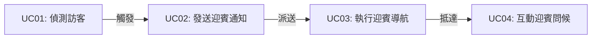
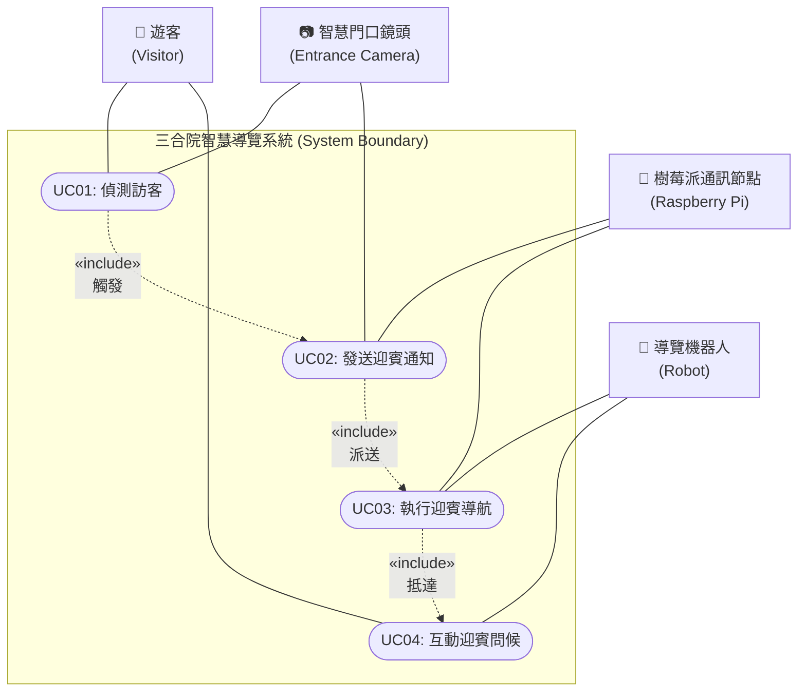
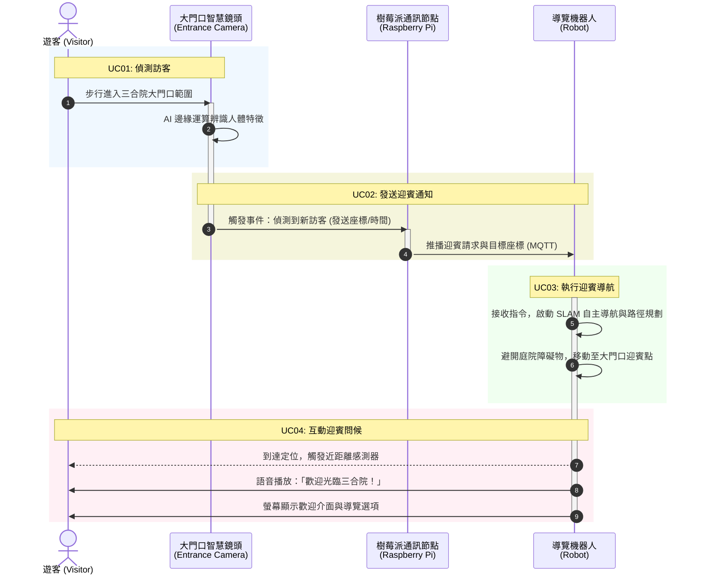

# 三合院智慧導覽系統 (Sanheyuan Smart Multimedia Guide)

本專案致力於結合**邊緣運算 AI**、**物聯網通訊 (IoT)**、**自主移動機器人 (AMR / SLAM)** 與**多媒體語音互動**技術，為傳統文化場域（如三合院古蹟、歷史建築園區）打造全自主、低延遲的智慧導覽解決方案。

---

## 📌 系統核心參與者 (Actors)

| 角色 | 英文名稱 | 職責與能力 |
| :--- | :--- | :--- |
| **遊客** | Visitor | 參訪民眾，進入園區並與導覽機器人進行語音及觸控螢幕互動。 |
| **大門口智慧鏡頭** | Entrance Camera | 具備邊緣運算（Edge AI）能力，透過 YOLO 物件偵測技術即時辨識進入大門的訪客。 |
| **樹莓派通訊節點** | Raspberry Pi Gateway | 負責門口事件接收、MQTT中繼、簡易排程及樹莓派與Jetson之間的狀態同步。 |
| **導覽機器人** | Guide Robot | 搭載光達（LiDAR）、超音波感測器與 SLAM 自主導航系統，具備多媒體螢幕與在地化語音互動功能。 |

---

## 🚀 核心導覽迎賓流程 (UC01 ~ UC04)

### 1. UC01：偵測訪客 (Detect Visitor)
* **前置條件**：門口監控系統處於上線運作狀態。
* **流程**：訪客踏入三合院大門範圍，邊緣運算智慧鏡頭即時捕捉影像並透過 AI 模型（如 YOLO）確認人體特徵。
* **結果**：成功觸發辨識事件，產生訪客位置與時間特徵數據。

### 2. UC02：發送迎賓通知 (Send Greeting Notification)
* **前置條件**：UC01 成功偵測到訪客。
* **流程**：鏡頭封裝事件資料，經由 Wi-Fi 與 MQTT 協議送往現場樹莓派節點，系統過濾短時間內的重複訊號並通知導覽機器人執行迎賓。
* **結果**：導覽機器人接收到迎賓請求與目標大門座標。

### 3. UC03：執行迎賓導航 (Execute Greeting Navigation)
* **前置條件**：機器人處於待命或充電狀態，已建置三合院場域 2D/3D 地圖。
* **流程**：喚醒驅動馬達與光達感測器，結合 SLAM 自主路徑規劃，動態閃避庭院植物、石桌等障礙物移動至大門迎賓點。
* **結果**：機器人順利抵達大門口預設迎賓停靠點。

### 4. UC04：互動迎賓問候 (Interactive Greeting)
* **前置條件**：機器人到達迎賓點且偵測到遊客距離小於 1.5 公尺。
* **流程**：播放親切在地化語音（「歡迎光臨三合院！」），並於觸控螢幕上點亮歡迎介面，提供「開始導覽」、「景點地圖」等選項。
* **結果**：完成初次破冰與迎賓互動，引導進入主體導覽流程。

---

## 📊 UML 系統設計架構圖

### UML 用例圖 (Use Case Diagram)

### UML 循序圖 (Sequence Diagram)

---

## 🏛️ 場域實證：彰化縣定古蹟「大村武魁新厝」（武魁祠）
* **地理位置**：彰化縣大村鄉貢旗村貢旗一巷 7 號（[Google 地圖](https://maps.app.goo.gl/TZW9MKjQZp8vuEh39)）
* **文史背景**：清咸豐九年（1859年）賴步雲、賴登雲兄弟同榜高中武舉人（第54、55名），獲贈「武魁」與「兄弟同榜」匾，立旗祭祖得名「貢旗村」。

---

## 🌐 3D 互動浮島網頁 (Heart Island Style)
* 參考沈伯洋 **「HEART 政策島」(https://puma.taipei/heart-island)** 設計理念。
* **12 個獨立用例 (UC01 ~ UC12)**：每個用例皆為獨立 3D 浮島節點，支援平滑鏡頭特寫、AMR 自主尋路與側邊抽屜式完整規格。
* **一鍵啟動**：在專案根目錄雙擊 [start-web.bat](file:///d:/大學/畢業製作/區域性自主移動式機器人/agent/start-web.bat) 即可於瀏覽器體驗。

---

* **古蹟實景具象化 3D 建模**：
  * **五開間正身**：中央「凹壽」退縮門廳、三關六扇門、福建巡撫慶端贈「兄弟同榜」立體金匾、雙層硬山燕尾脊。
  * **懸山軒亭（拜亭）**：四柱福州杉木圓柱與花崗石柱珠、懸山馬背頂。
  * **獨立燕尾門樓**：高懸「武魁」黑底金字大匾、兩側綠釉花磚透窗與斗仔砌院牆。
  * **半月形風水池**：倒映燕尾天際線、弧形石砌駁岸與水生睡蓮。
  * **賴氏雙舉人旗杆座**：雙層花崗石夾柱、旗杆斗與咸豐九年武舉人旌旗。
  * **大村巨峰葡萄藤架**：彰化大村「葡萄之鄉」在地農業景觀與綠能自主充電基座。

---

## 📂 文件與系統清單 (Repository Structure)

* [README.md](file:///d:/大學/畢業製作/區域性自主移動式機器人/agent/README.md)：專案總覽、大村武魁祠場域、系統架構及流程規格說明。
* **[3D 互動浮島網頁系統 (web/)](file:///d:/大學/畢業製作/區域性自主移動式機器人/agent/web/index.html)**：卡坦島 3D 浮島大村武魁祠 AMR 12 個獨立用例互動網頁。
* [start-web.bat](file:///d:/大學/畢業製作/區域性自主移動式機器人/agent/start-web.bat)：Windows 滑鼠雙擊一鍵在瀏覽器啟動 3D 互動網頁。
* [UC01-UC04 (Use Case Specifications).md](file:///d:/大學/畢業製作/區域性自主移動式機器人/agent/UC01-UC04%20(Use%20Case%20Specifications).md)：詳細用例規格書與循序圖定義。
* [UC05-UC07.md](file:///d:/大學/畢業製作/區域性自主移動式機器人/agent/UC05-UC07.md)：庭院導覽、正廳歷史解說、廂房常民文化展示。
* [UC08-UC10.md](file:///d:/大學/畢業製作/區域性自主移動式機器人/agent/UC08-UC10.md)：多媒體互動問答、導覽結束歡送、系統自動返航充電。
* [UC11-UC12.md](file:///d:/大學/畢業製作/區域性自主移動式機器人/agent/UC11-UC12.md)：表情辨識主動關懷、手勢辨識請求協助。

---

## 🛠️ 技術範疇 (Tech Stack)

* **電腦視覺 & 邊緣運算**：YOLO / OpenCV 人體辨識與追蹤
* **機器人自主移動**：ROS / ROS 2、SLAM 建圖導航、光達（LiDAR）與超音波避障
* **通訊協定與現場通訊**：樹莓派 MQTT Broker、Jetson ROS 2 Bridge、局域網
* **人機互動 (HMI)**：在地化語音合成 (TTS)、觸控式導覽介面
