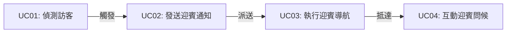
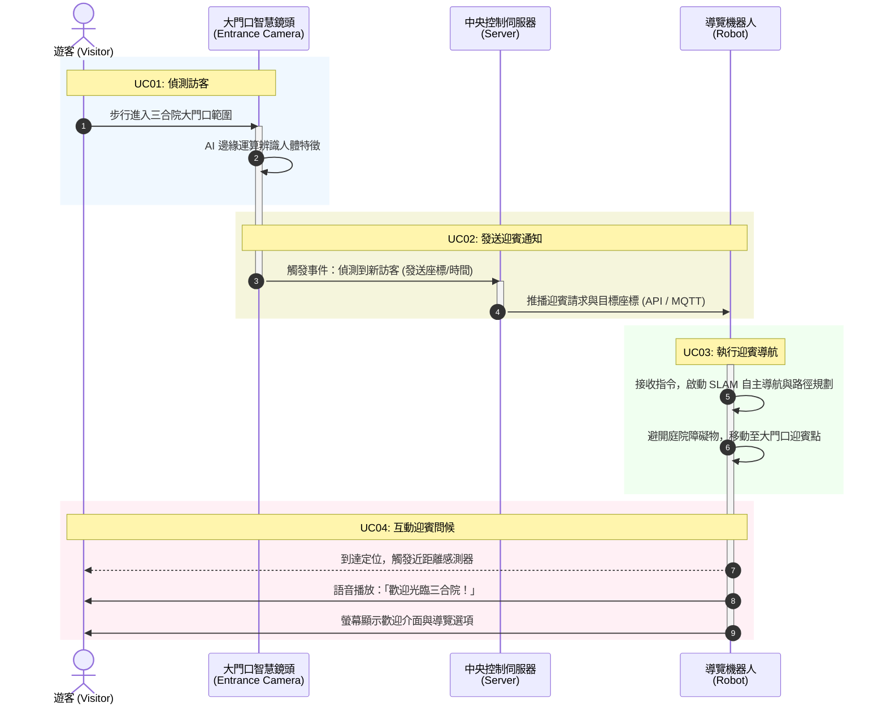

# 三合院智慧導覽系統 (Sanheyuan Smart Multimedia Guide)

本專案致力於結合**邊緣運算 AI**、**物聯網通訊 (IoT)**、**自主移動機器人 (AMR / SLAM)** 與**多媒體語音互動**技術，為傳統文化場域（如三合院古蹟、歷史建築園區）打造全自主、低延遲的智慧導覽解決方案。

---

## 📌 系統核心參與者 (Actors)

| 角色 | 英文名稱 | 職責與能力 |
| :--- | :--- | :--- |
| **遊客** | Visitor | 參訪民眾，進入園區並與導覽機器人進行語音及觸控螢幕互動。 |
| **大門口智慧鏡頭** | Entrance Camera | 具備邊緣運算（Edge AI）能力，透過 YOLO 物件偵測技術即時辨識進入大門的訪客。 |
| **中央控制伺服器** | Central Server | 負責中繼協調與事件排程，接收感測訊號並透過 MQTT / REST API 派送導航迎賓任務。 |
| **導覽機器人** | Guide Robot | 搭載光達（LiDAR）、超音波感測器與 SLAM 自主導航系統，具備多媒體螢幕與在地化語音互動功能。 |

---

## 🚀 核心導覽迎賓流程 (UC01 ~ UC04)

### 1. UC01：偵測訪客 (Detect Visitor)
* **前置條件**：門口監控系統處於上線運作狀態。
* **流程**：訪客踏入三合院大門範圍，邊緣運算智慧鏡頭即時捕捉影像並透過 AI 模型（如 YOLO）確認人體特徵。
* **結果**：成功觸發辨識事件，產生訪客位置與時間特徵數據。

### 2. UC02：發送迎賓通知 (Send Greeting Notification)
* **前置條件**：UC01 成功偵測到訪客。
* **流程**：鏡頭封裝事件資料，經由 Wi-Fi 與 MQTT / API 協議送往中控伺服器，系統自動過濾短時間內的重複訊號並派發迎賓指令。
* **結果**：導覽機器人接收到迎賓請求與目標大門座標。

### 3. UC03：執行迎賓導航 (Execute Greeting Navigation)
* **前置條件**：機器人處於待命或充電狀態，已建置三合院場域 2D/3D 地圖。
* **流程**：喚醒驅動馬達與光達感測器，結合 SLAM 自主路徑規劃，動態閃避庭院植物、石桌等障礙物移動至大門迎賓點。
* **結果**：機器人順利抵達大門口預設迎賓停靠點。

### 4. UC04：互動迎賓問候 (Interactive Greeting)
* **前置條件**：機器人到達迎賓點且偵測到遊客距離小於 1.5 公尺。
* **流程**：播放親切在地化語音（「歡迎光臨三合院！」），並於觸控螢幕上點亮歡迎介面，提供「開始導覽」、「景點地圖」等選項。
* **結果**：完成初次破冰與迎賓互動，引導進入主體導覽流程。

---

## 📊 UML 系統設計架構圖

### UML 用例圖 (Use Case Diagram)

### UML 循序圖 (Sequence Diagram)

---

## 📂 文件清單 (Repository Structure)

* [README.md](file:///home/stronger/Projects/mobile-multimedia-guide/README.md)：專案總覽、系統架構及流程規格說明。
* [UC01-UC04 (Use Case Specifications).md](file:///home/stronger/Projects/mobile-multimedia-guide/UC01-UC04%20(Use%20Case%20Specifications).md)：詳細用例規格書與循序圖定義。
* [三合院智慧導覽系統：UML 用例圖 (Use Case Diagram).md](file:///home/stronger/Projects/mobile-multimedia-guide/%E4%B8%89%E5%90%88%E9%99%A2%E6%99%BA%E6%85%A7%E5%B0%8E%E8%A6%BD%E7%B3%BB%E7%B5%B1%EF%BC%9AUML%20%E7%94%A8%E4%BE%8B%E5%9C%96%20(Use%20Case%20Diagram).md)：系統參與者邊界與用例圖 Mermaid 原始碼。
* [gemini-code-UC01-UC04.md](file:///home/stronger/Projects/mobile-multimedia-guide/gemini-code-UC01-UC04.md)：循序圖 Mermaid 代碼備份。

---

## 🛠️ 技術範疇 (Tech Stack)

* **電腦視覺 & 邊緣運算**：YOLO / OpenCV 人體辨識與追蹤
* **機器人自主移動**：ROS / ROS 2、SLAM 建圖導航、光達（LiDAR）與超音波避障
* **通訊協定與中控**：MQTT Broker、RESTful API、WebSocket
* **人機互動 (HMI)**：在地化語音合成 (TTS)、觸控式導覽介面
