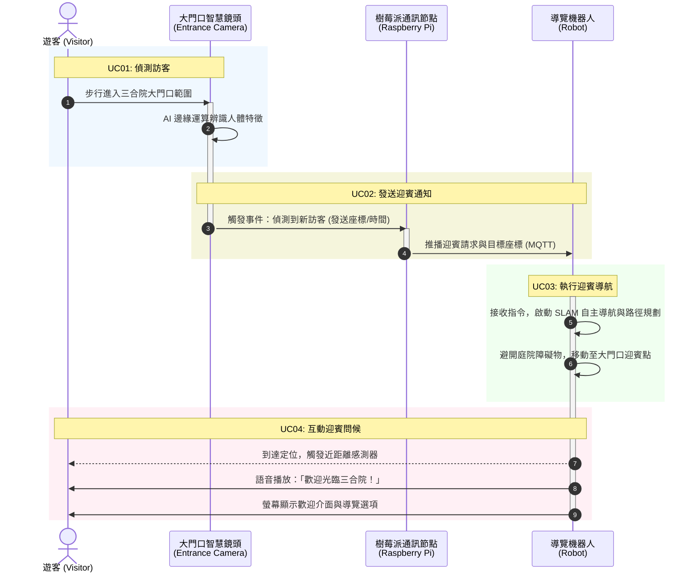

為您針對 **UC01 至 UC04（從訪客偵測到迎賓問候）** 規劃專業的 **UML 循序圖 (Sequence Diagram)** 與 **用例詳細規格說明**。

您可以將下方的 PlantUML 程式碼貼至任何 PlantUML 檢視器（如 VS Code 擴充功能、PlantText 線上工具）中渲染成圖形。

---

## 一、 UC01 ~ UC04 UML 循序圖 (Sequence Diagram)

# 三合院智慧導覽系統：UC01 至 UC04 UML 循序圖與用例圖

## 一、 UML 循序圖 (Sequence Diagram)

---

## 二、 UC01 至 UC04 用例詳細規格 (Use Case Specifications)

### UC01：偵測訪客 (Detect Visitor)

* **參與者**：智慧門口鏡頭、遊客
* **前置條件**：門口監控系統處於上線運作狀態。
* **主要事件流**：

1. 遊客通過三合院外牆大門或穿過庭院入口。
2. 門口設置的 AI 智慧鏡頭捕捉即時影像串流。
3. 內建邊緣運算晶片執行物件偵測（YOLO等演算法），確認畫面中出現人類。

* **後置條件**：成功觸發影像辨識事件，取得訪客初步位置與畫面特徵。

### UC02：發送迎賓通知 (Send Greeting Notification)

* **參與者**：智慧門口鏡頭、樹莓派、導覽機器人
* **前置條件**：UC01 成功偵測到訪客。
* **主要事件流**：

1. 門口鏡頭將辨識結果封裝為資料封包。
2. 透過區域網路無線通訊（Wi-Fi / MQTT 協議）將「訪客到達」訊號發送至樹莓派，再由樹莓派通知導覽機器人。
3. 系統過濾短時間內的重複觸發（避免頻繁干擾）。

* **後置條件**：機器人接收到迎賓任務與入口座標數據。

### UC03：執行迎賓導航 (Execute Greeting Navigation)

* **參與者**：導覽機器人
* **前置條件**：機器人處於待命或充電狀態，並已載入三合院場域地圖。
* **主要事件流**：

1. 機器人接收到來自大門的迎賓指令。
2. 自動結束待命狀態，喚醒驅動馬達與感測器（光達、超音波）。
3. 系統即時調用三合院 2D/3D 地圖，規劃由充電樁至大門口的安全導航路徑。
4. 機器人自主移動，動態避開庭院中的植栽、石桌或臨時障礙物。

* **後置條件**：機器人順利抵達大門口預設的迎賓停靠點。

### UC04：互動迎賓問候 (Interactive Greeting)

* **參與者**：導覽機器人、遊客
* **前置條件**：機器人已到達大門口迎賓點。
* **主要事件流**：

1. 機器人透過超音波或深度相機確認遊客距離小於 1.5 公尺。
2. **語音輸出**：播放親切的在地化歡迎語音（例如：「歡迎蒞臨古色古香的三合院，我是您的專屬導覽機器人……」）。
3. **視覺互動**：機器人身上的觸控螢幕點亮，顯示歡迎動畫及「開始導覽」、「查詢園區」等互動按鈕。

* **後置條件**：完成破冰與迎賓，準備進入後續的庭院與建築導覽流程。