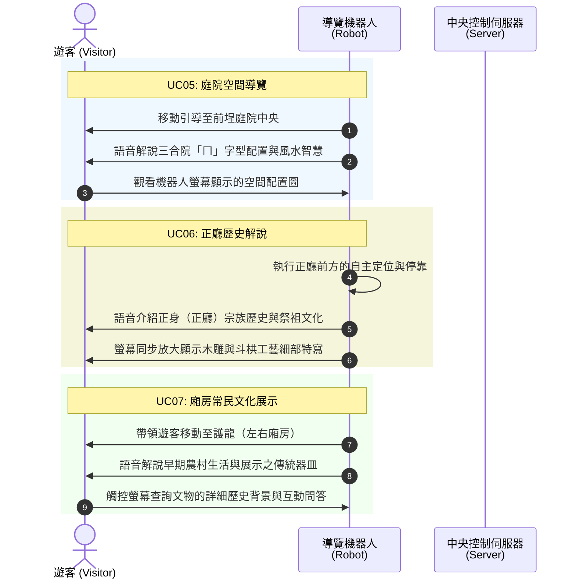
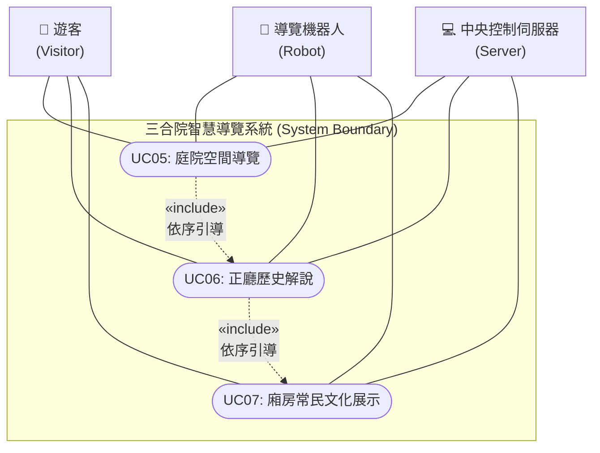

為您規劃 **UC05 至 UC07（庭院導覽、正廳歷史解說、廂房常民文化展示）** 的 UML 用例圖與循序圖，並包裝成可以直接複製並於 Markdown 中預覽的格式：

```markdown
# 三合院智慧導覽系統：UC05 至 UC07 UML 循序圖與用例圖

## 一、 UC05 ~ UC07 UML 循序圖 (Sequence Diagram)



## 二、 UC05 ~ UC07 UML 用例圖 (Use Case Diagram)



## 三、 UC05 至 UC07 用例詳細規格 (Use Case Specifications)

### UC05：庭院空間導覽 (Courtyard Spatial Tour)

* **參與者**：導覽機器人、遊客
* **前置條件**：完成迎賓問候與導覽模式選擇。
* **主要事件流**：
1. 機器人依據排程路徑，以安全速度帶領遊客移動至前埕（庭院）中央。
2. 機器人播放語音，解說三合院的建築佈局（如坐北朝南、護龍配置）與前埕的曬穀、社交功能。
3. 遊客透過機器人螢幕檢視庭院空間的空拍視角或歷史演變對照圖。


* **後置條件**：完成庭院階段解說，準備移動至正廳。

### UC06：正廳歷史解說 (Main Hall Historical Interpretation)

* **參與者**：導覽機器人、遊客
* **前置條件**：完成 UC05 庭院導覽。
* **主要事件流**：
1. 機器人自主導航至正身（正廳）前方指定的停靠點。
2. 語音解說正廳作為宗族精神核心的歷史意義與祭祖禮俗。
3. 同步於觸控螢幕展示傳統建築工藝（如凹壽、木雕、瓦當滴水）的特寫影像與典故。


* **後置條件**：完成正廳歷史與工藝解說，準備前往廂房。

### UC07：廂房常民文化展示 (Wing Folk Culture Exhibition)

* **參與者**：導覽機器人、遊客
* **前置條件**：完成 UC06 正廳歷史解說。
* **主要事件流**：
1. 機器人引導遊客移動至護龍（左右廂房）展示區。
2. 語音介紹昔日農村家庭的生活分工與常民文化特色。
3. 遊客可透過機器人螢幕點選展示區的農具、生活器皿，進行深入的數位圖文閱讀或趣味益智問答。


* **後置條件**：完成各展區主體導覽，準備進入互動問答與歡送階段（UC08 ~ UC09）。

```

```