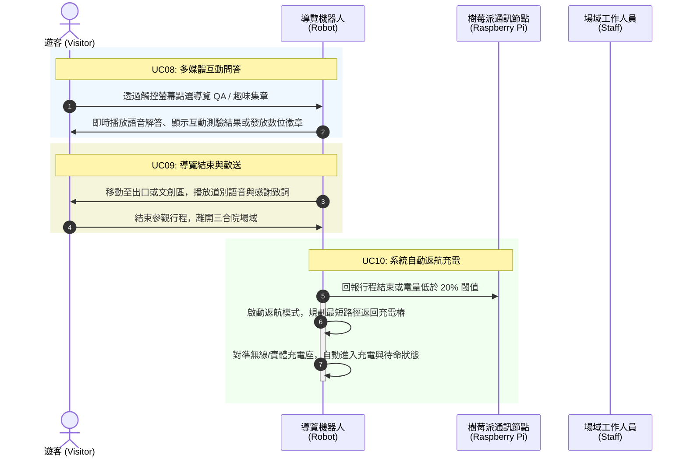
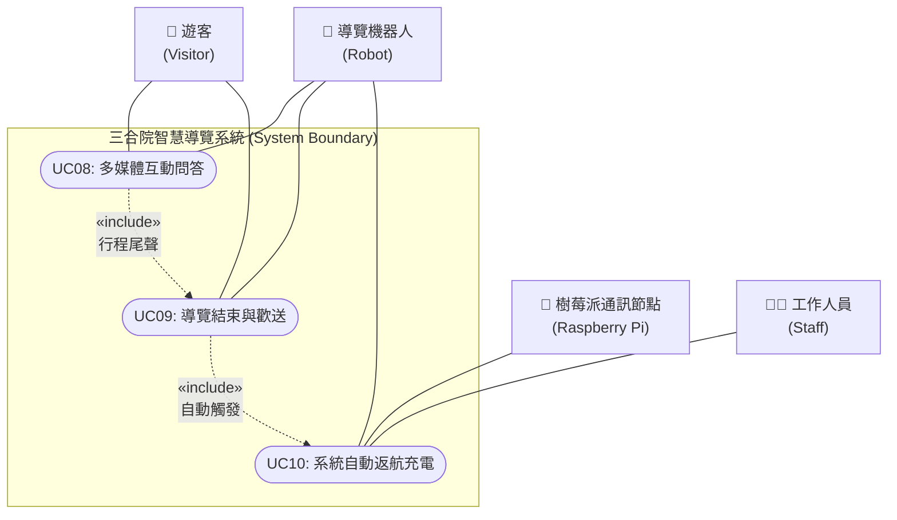

為您規劃 **UC08 至 UC10（多媒體互動問答、導覽結束歡送、系統自動返航充電）** 的 UML 用例圖與循序圖，並包裝成可以直接複製並於 Markdown 中預覽的格式：

```markdown
# 三合院智慧導覽系統：UC08 至 UC10 UML 循序圖與用例圖

## 一、 UC08 ~ UC10 UML 循序圖 (Sequence Diagram)



## 二、 UC08 ~ UC10 UML 用例圖 (Use Case Diagram)



## 三、 UC08 至 UC10 用例詳細規格 (Use Case Specifications)

### UC08：多媒體互動問答 (Multimedia Interactive QA)

* **參與者**：導覽機器人、遊客
* **前置條件**：完成各展區主體導覽（UC05~UC07），或於行程中特定駐留點。
* **主要事件流**：
1. 遊客透過機器人觸控螢幕點選「趣味問答」、「建築知識挑戰」或「數位集章」。
2. 機器人根據遊客選擇提供多媒體影音互動、燈光或音效回饋。
3. 遊客完成互動後可獲取數位紀念憑證或園區導覽地圖。


* **後置條件**：完成互動體驗，準備引導遊客結束行程。

### UC09：導覽結束與歡送 (Tour Conclusion and Farewell)

* **參與者**：導覽機器人、遊客
* **前置條件**：完成所有展區導覽與互動問答。
* **主要事件流**：
1. 機器人帶領遊客移動至三合院出口、大門口或文創紀念品販售處。
2. 機器人播放道別語音（例如：「感謝您的參與，希望您喜歡今天的三合院文化之旅，我們下次見！」）。
3. 遊客向機器人道別並離開場域。


* **後置條件**：確認遊客已離開互動範圍，機器人進入待命結算狀態。

### UC10：系統自動返航充電 (Auto Return and Charging)

* **參與者**：導覽機器人、樹莓派、工作人員
* **前置條件**：導覽行程結束（UC09）或機器人電池電量低於設定的安全閾值（如 20%）。
* **主要事件流**：
1. 機器人向樹莓派通訊節點發送狀態更新，或自主觸發低電量返回程序。
2. 啟動 SLAM 自主導航，避開場域內臨時障礙物，沿安全路徑返回室內或角落的充電樁位置。
3. 機器人精準對位並接通充電介面（實體接點或無線充電）。
4. 系統自動切換至休眠/充電模式，並發送狀態回報至後台管理系統。


* **後置條件**：機器人安全完成充電對位，電力開始回補，等待下一次的訪客偵測觸發。

```

```