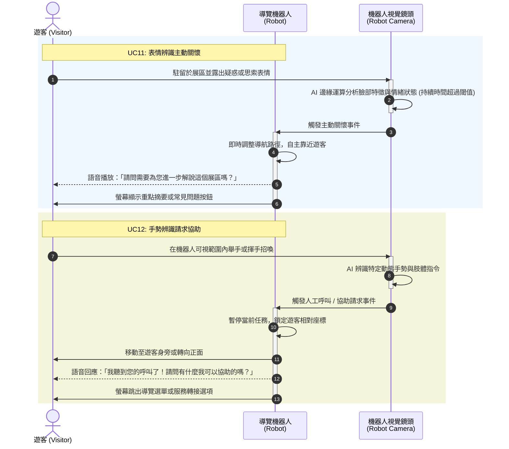
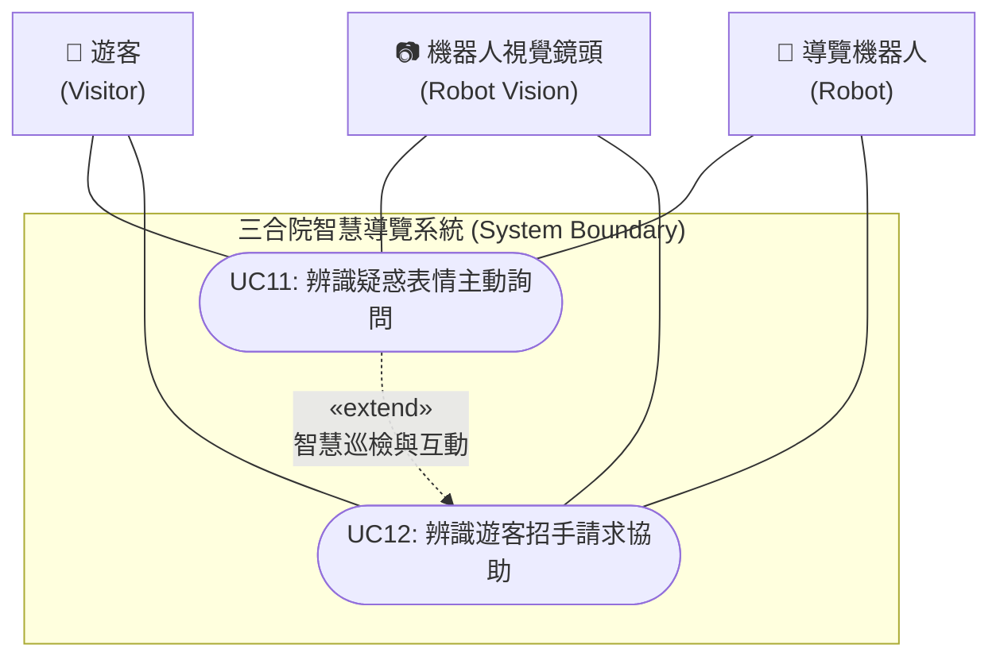

為您新增 **UC11（表情辨識主動關懷）** 與 **UC12（手勢辨識請求協助）**，並整合完整的 UML 用例圖與循序圖，包裝成可以直接複製並於 Markdown 中預覽的格式：

```markdown
# 三合院智慧導覽系統：UC11 與 UC12 擴充功能 UML 循序圖與用例圖

## 一、 UC11 ~ UC12 UML 循序圖 (Sequence Diagram)



## 二、 UC11 ~ UC12 UML 用例圖 (Use Case Diagram)



## 三、 UC11 與 UC12 用例詳細規格 (Use Case Specifications)

### UC11：影像辨識到遊客持續疑惑表情，導覽機器人上前詢問需求 (Facial Expression Recognition & Proactive Assistance)

* **參與者**：導覽機器人、機器人視覺鏡頭、遊客
* **前置條件**：機器人處於導覽解說中或場域巡檢待命狀態，且視覺鏡頭正常運作。
* **主要事件流**：
1. 遊客在參觀三合院展品時，因對歷史背景或文物感到疑惑而停下並皺眉、露出思索表情。
2. 機器人內建的 RGB 深度相機結合 AI 表情辨識模組，偵測到特定遊客的疑惑表情持續超過設定秒數。
3. 機器人自主中斷或放慢當前行程，規劃一條安全短距的路徑靠近該遊客。
4. 機器人抵達合適距離後，以語音溫和詢問：「我看您對這個展品很感兴趣，需要我為您補充更多歷史小故事嗎？」並於螢幕顯示相關圖文。


* **後置條件**：遊客接受協助（進入深度解說或互動 QA）或機器人恢復常態巡導。

### UC12：遊客在可見到導覽機器人的位置招手請求協助 (Gesture Recognition & Call for Help)

* **參與者**：導覽機器人、機器人視覺鏡頭、遊客
* **前置條件**：機器人處於遊客視線範圍內（庭院或展區內）。
* **主要事件流**：
1. 遊客因有即時需求（如尋找洗手間、重複聽取解說），在機器人前方或側邊可視範圍內進行「揮手」或「舉手」等特定肢體手勢。
2. 機器人鏡頭透過手勢辨識演算法（Gesture Recognition）捕捉並確認為呼叫指令。
3. 機器人立即中斷當前閒置或移動狀態，轉向遊客方向並自主導航靠近。
4. 機器人發出語音回應：「請問您需要甚麼協助？」並於觸控螢幕列出常用互動選項（如：重播上一段解說、導引至洗手間、呼叫現場工作人員）。


* **後置條件**：完成遊客即時訴求之響應與處理。

```

```